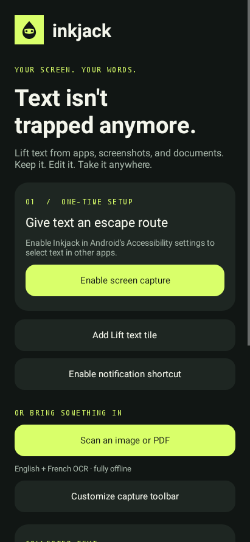
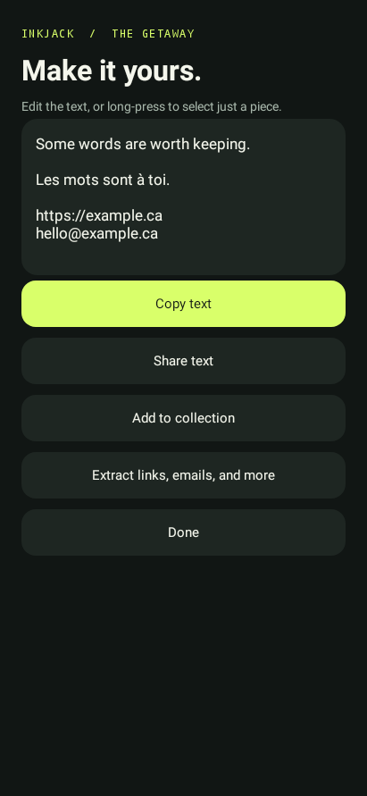

# Inkjack

**Text isn't trapped anymore.**

An independent, open-source Android app for lifting text from apps, screenshots, images, and PDFs. Select the words you need, fix them up, and take them anywhere.

Native Android. Offline Tesseract OCR. No ads, accounts, analytics, or internet permission.

<p>
  
  
</p>

## What it does

| Feature | How it works |
| --- | --- |
| Screen text | Reads visible accessibility text on demand. Tap outlined regions to select them. |
| Screen OCR | Tap **Scan image** in the overlay to recognize text that apps don't expose. |
| Image and PDF import | Open a file or share it to Inkjack. PDFs support up to 20 pages per import. |
| Precise selection | Long-press a box to edit it, or use **Review** and Android's text selection handles. |
| Multi-screen stash | Collect selections, scroll or switch apps, capture again, then combine your stash. |
| Entity extraction | Pull out emails, URLs, phone numbers, @handles, and #hashtags. |
| Copy and share | Copy all text or just the selected substring. Share through Android's chooser. |
| Fast activation | Quick Settings tile, optional notification, and Android's accessibility button. |
| Offline languages | English and French models bundled in the APK, with a language picker. |

Requires **Android 11 or newer** (API 30). Tablets and foldables use the same responsive native layouts.

This is an early independent implementation inspired by Universal Copy's public functionality. It is not affiliated with Camel Corporation and includes none of its code or artwork. It does not claim complete feature parity: there is no unattended harvesting, QR recognition, automatic scrolling, or built-in translation. Other scripts can be added by extending the pinned model list and language picker.

## Try it

1. Install a debug APK from a successful **Android** workflow's `inkjack-debug` artifact, or build one below.
2. Open Inkjack, read the disclosure, and enable it under Android **Settings → Accessibility → Inkjack**.
3. Add the **Lift text** Quick Settings tile. On Android 13+, the app can request this for you.
4. Open another app, activate **Lift text**, and tap the outlined text.
5. Choose **Copy**, **Stash**, or **Review**. If the app exposes no useful text, choose **Scan image**.

For images and PDFs, **Scan an image or PDF** works without enabling accessibility. You can also use another app's Share menu.

On some Android versions, sideloaded accessibility apps are blocked until you open Inkjack's system App info, use its overflow menu, and select **Allow restricted settings**. Only do this for an APK built from source you trust.

## Build

Install JDK 17, Python 3, and the Android SDK (platform 35 and build tools 35.0.0), or open the project in Android Studio. Point `ANDROID_HOME` at the SDK, or create an untracked `local.properties` containing `sdk.dir=/path/to/sdk`.

```sh
./gradlew testDebugUnitTest lintDebug assembleDebug
```

The APK is at `app/build/outputs/apk/debug/app-debug.apk`.

The first build needs network access for Gradle dependencies and two SHA-256-verified OCR models. Models come from the pinned `tessdata_fast` 4.1.0 release. Subsequent builds reuse verified files; the installed app never downloads anything. To prepare models separately:

```sh
python3 scripts/fetch_models.py app/build/generated/ocrAssets/tessdata
```

Debug APKs use the building machine's debug certificate. To distribute upgrades consistently, build release APKs using a stable signing key you control. No signing key or personal credential belongs in this repository.

## Privacy and permissions

- Accessibility access is used only after an explicit capture action. Accessibility events never trigger capture or collection.
- Password nodes and their descendants are excluded from normal screen capture.
- Android-protected screens cannot be OCR-captured. Inkjack does not bypass protected windows.
- Screenshots stay in memory until the overlay closes. Imported documents are read through Android's document picker; Inkjack does not retain copies.
- Extracted text and the stash live in process memory. The stash is not permanent storage, and can be lost when Android terminates the process.
- Only OCR model files and the chosen language/notification preference are stored privately on disk. Android backups are disabled.
- Notification permission is optional on Android 13+. There is no broad storage permission, overlay permission, camera permission, or internet permission.
- Copy and Share explicitly send your chosen text to the system clipboard or the app you pick.

See [PRIVACY.md](PRIVACY.md) for the complete policy and [docs/TESTING.md](docs/TESTING.md) for device checks and known limits.

## Structure

- `InkAccessibilityService`: user-triggered capture, screen OCR, shortcut lifecycle.
- `NodeReader`: bounded accessibility traversal with password/offscreen filtering.
- `SelectionOverlay`: selection rectangles, editing handoff, and multi-screen stash.
- `OcrEngine`: single-worker Tesseract lifecycle, image decoding, bounded PDF rendering.
- `MainActivity` / `ResultActivity`: setup, import, editing, copy/share, entity extraction.
- `TextTools`: deterministic text extraction and bounded in-memory collection.

## Contributing

Bug reports and small pull requests are welcome. Include your Android version, device, capture mode, and a nonsensitive reproduction. Never attach private screen text, passwords, or personal documents to an issue. Run the build command above before opening a PR.

## License

Apache License 2.0. See [LICENSE](LICENSE) and [NOTICE](NOTICE). Third-party component sources and licenses are listed in [THIRD_PARTY.md](THIRD_PARTY.md).
